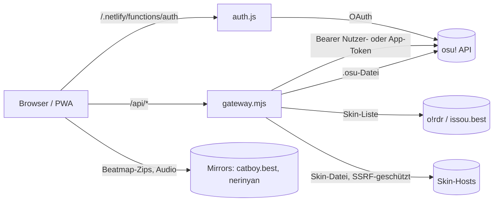

# Architektur

## Anmeldung
1. `auth` (ohne `code`) erzeugt einen zufälligen `state`, setzt ihn als HttpOnly-Cookie `osu_st` und leitet zu osu! weiter.
2. osu! ruft `auth?code=…&state=…` auf. Der Server prüft `state`, tauscht den Code gegen ein Token und setzt `osu_t` (HttpOnly, Secure, SameSite=Lax). Das Token ist für JavaScript nicht lesbar.
3. Das Frontend ruft nur `/api/*` auf; der Server hängt das Token an.

## API-Gateway (`/api/*`)
| Route | Zugriff | Zweck |
|---|---|---|
| `/api/osu?path=…` | Gast für öffentliche Pfade, sonst Login | osu!-API-Proxy, nur freigegebene Pfade und Parameter (`OSU_ROUTES`) |
| `/api/beatmap?id=` | öffentlich | `.osu`-Datei |
| `/api/skins` | Login | Skin-Liste (o!rdr) |
| `/api/skin?u=` | Login | Skin-Download über SSRF-geschützten Proxy |

**Gastmodus:** Fehlt der Login, holt das Gateway ein App-Token (Client Credentials, Scope `public`, im Speicher gecacht) und beantwortet nur Routen mit `guest: true` (Suche, Scores, Most-Played). `/me/osu` und Replay-Downloads antworten `401 login_required`.

**Neue Route hinzufügen:** Eintrag in `OSU_ROUTES` mit Pfad-Regex und Parameter-Validatoren, `guest: true` nur für öffentliche Daten, Test in `tests/gateway.test.mjs` ergänzen.

## Rate-Limits
1. Netlify-Regel am Edge: 120 Anfragen/Minute/IP für `/api/*` (`config.rateLimit`). Free-Pläne erlauben nur 2 Regeln, daher eine gemeinsame Funktion.
2. Zusatz-Limiter je Route im Funktionsspeicher (best effort, pro Instanz).

## Frontend
Alles in `public/index.html` (CSS, HTML, zwei Inline-Skripte). Offline-Cache über `sw.js`. Replay-Rendering auf Canvas, `.osr`-Parser und LZMA lokal (`public/vendor/`). Das Spiel `public/nicominecith/` ist ein fertiger Build und läuft im iframe (eigene, lockerere CSP).

## Spiel-Menü: Map-Import und Schließen (`public/nicominecith/assets/*.js`)
- Kein Overlay mehr: Die Bedienung sitzt im Spielmenü selbst (Einstellungen → Maintenance → „Osu Replay") und im Hauptmenü („Import", „Exit").
- Die Host-App stellt `window.nicoHost` bereit (`public/index.html`): `close()` schließt das Spiel, `importMaps()` lädt Maps aus dem osu!-Konto über mehrere Mirrors (ZIP-Signatur und Größe werden geprüft).
- Im Spiel gibt es dazu drei Methoden an der Game-Klasse: `pickFiles()` (robuster Datei-Dialog für Handys), `importAccount()` (ruft `nicoHost.importMaps()` und übergibt jede Datei direkt an `importFiles()`) und `closeGame()`.
- Hinweis: Die Spiel-Dateien sind ein fertiger Build (minifiziert). Änderungen daran sind Patches; `tests/nico-game-menu.test.mjs` prüft, dass sie vorhanden sind.

## Bekannte technische Schulden
- `index.html` ist eine einzige große Datei. Aufteilen in Module/Build (z. B. Vite) wäre der nächste Schritt und würde `'unsafe-inline'` in der CSP überflüssig machen.
- Nur osu!standard wird unterstützt.
- Keine End-to-End-Tests im Browser.
